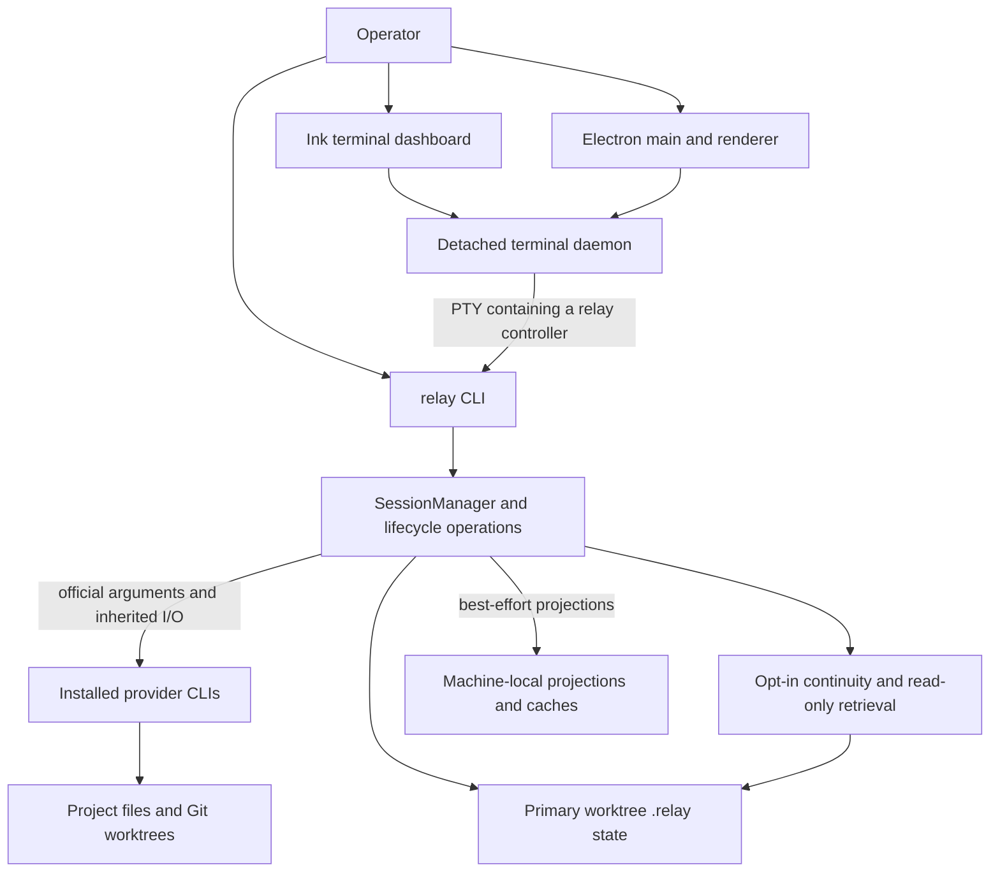
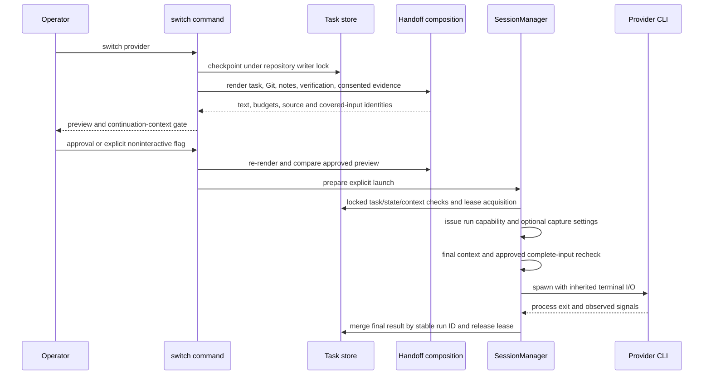

# Architecture

Rirei is a local control plane around installed coding-agent CLIs. `relay` is its Commander/
TypeScript command engine; Ink supplies a terminal dashboard and Electron supplies the desktop
shell. Provider CLIs own model execution, authentication, billing, conversation storage, and
permissions. Rirei owns task records, cooperative run ownership, local coordination, and handoff
preparation.

**Scope:** this page includes the experimental continuity implementation in the alpha.5.5 CLI.
Alpha.5.1 did not include that feature. Provider and platform acceptance, and measured efficiency,
are qualified separately.

## Architecture reading map

| Document                                              | Question it answers                                                                               |
| ----------------------------------------------------- | ------------------------------------------------------------------------------------------------- |
| [Architecture decisions](architecture-decisions.md)   | What was chosen, why, what it costs, and which implementation/tests support it                    |
| [Runtime protocols](runtime-protocols.md)             | How processes, terminal control, IPC, lifecycle signals, and frontends interact                   |
| [Continuity architecture](continuity-architecture.md) | How capture becomes requirements, snapshots, receipts, inspection, retrieval, and policy previews |
| [Documentation audit](architecture-audit.md)          | What was missing/stale, what is now covered, and what remains unqualified or outside scope        |
| [State and events](state-and-events.md)               | Persistent schemas, mutation, migrations, activity, and terminal journals                         |
| [Security](security.md)                               | Authority, credentials, local capabilities, path checks, and their limits                         |

The decision records are retrospective unless a linked plan already records the rationale.
They explain the engineering tradeoff without claiming to recover an author's undocumented intent.

## System boundary

A daemon PTY normally contains a `relay run`, `switch`, or `resume` controller, which then starts
the provider. This gives the provider a real terminal while retaining CLI-based task/lease
semantics. An ordinary shell tab uses the daemon without requiring an initialized task.

The TypeScript `ProcessHost` contract and native `TerminalHost` contract have different roles:
the former hosts a provider process for `SessionManager`; the latter supplies PTY byte I/O,
resize, interrupt, and tree termination for the daemon. They are not interchangeable stores.

## Source map

| Area                      | Main implementation                                                                                        | Responsibility                                                                                                                                   |
| ------------------------- | ---------------------------------------------------------------------------------------------------------- | ------------------------------------------------------------------------------------------------------------------------------------------------ |
| Entry and commands        | `src/index.ts`, `src/cli/`                                                                                 | Parse command arguments, resolve actors/projects, invoke services, serialize output                                                              |
| Task application services | `src/application/project-setup.ts`, `sessions.ts`, `controller.ts`, `heartbeat.ts`, `reconciliation.ts`    | Task setup, stable run IDs, cooperative leases, lifecycle/finalization, ownership recovery                                                       |
| Shared lifecycle          | `src/lifecycle.ts`, `src/handoff.ts`                                                                       | Checkpoint creation, capsule composition, continuity composition, inherited-process launch wrapper                                               |
| Provider boundary         | `src/agents/adapter.ts`, `registry.ts`, `usage-collectors.ts`, `limit-detection.ts`                        | Capabilities, official arguments/discovery, resume, sanitized quota evidence and conservative classification                                     |
| Task persistence          | `src/state/`                                                                                               | Schema-v8 state, locks, revisions, task archives, notes, metadata history, activity and lifecycle journals                                       |
| Git and workspaces        | `src/git/repository.ts`, `src/worktrees/`                                                                  | Authority discovery, legacy Git inspection, local exclusion, previewed worktree creation, registry, cleanup inspection                           |
| Process and platform      | `src/process/`, `src/terminal/`, `src/platform/`                                                           | Inherited stdio, native PTY interface, executable/shell discovery, endpoints, daemon discovery, process-tree control                             |
| Coordination              | `src/messages/`, `desktop/threads-ipc.mjs`                                                                 | Task/run capabilities, strict message envelopes, manual inbox/acknowledgement, metadata-only notifications                                       |
| Quota and analytics       | `src/plan-usage.ts`, `src/usage.ts`, `src/token-usage/`                                                    | Separate provider quota observations and opt-in local numeric token analytics                                                                    |
| Continuity prototype      | `src/context/`, `src/cli/context.ts`                                                                       | Consent, capture, source journal, requirement selection, covered snapshots, receipts, inspection, exact retrieval, experimental policy rendering |
| Desktop runtime           | `desktop/main.mjs`, `preload.cjs`, `terminal-daemon*.mjs`, `daemon-bridge-worker.mjs`, `terminal-host.mjs` | Validated Electron bridge, detached PTYs, reconnect/control/output flow, synchronization back to the CLI                                         |
| Desktop rendering         | `desktop/renderer/`                                                                                        | xterm.js, task/session/usage views, local preferences, stale-request suppression, terminal rendering acknowledgements                            |
| Terminal dashboard        | `src/tui/`, `src/cli/tui.ts`, `attach.ts`                                                                  | First-task flow, provider selection, raw terminal attach/detach, inbox and usage views                                                           |
| Build/release             | `scripts/build.mjs`, package metadata, `.github/workflows/`                                                | CLI bundle, external native dependencies, desktop packaging, exact-tarball validation and optional publication                                   |
| Evaluation                | `benchmarks/handoff/`, `benchmarks/continuity/`                                                            | Separate historical harnesses, frozen controls, visible-event measurement, explicit launch budgets, offline qualification                        |

TypeScript uses `.js` import specifiers for NodeNext resolution. The production build bundles
the CLI as CommonJS, with native/ESM runtime dependencies deliberately external. The desktop
daemon is ESM and is also imported by the CLI daemon command; it is not an Electron-only service.

## Authorities, storage, and derived views

| Data                            | Authority / location                                       | Important distinction                                                                       |
| ------------------------------- | ---------------------------------------------------------- | ------------------------------------------------------------------------------------------- |
| Project implementation          | Actual selected worktree and Git                           | Rirei does not replace Git, isolate filesystem permissions, or automatically merge work     |
| Current task and run ownership  | Primary authority root `.relay/state.json`                 | Validated state; `runs` owns leases, scalar current-run fields are compatibility mirrors    |
| Workspace registry              | Primary root `.relay/workspaces.json`                      | Managed worktrees contain code; their task/coordination authority remains primary           |
| Task configuration              | `.relay/config.json`                                       | Honored and reserved fields are distinguished in [configuration](configuration.md)          |
| Checkpoint artifacts            | `.relay/checkpoints/<id>/`                                 | Bounded status/stat/patch records; no untracked-content backup and no automatic restore     |
| Archived task metadata          | `.relay/tasks/<session-id>/state.json`                     | Closed tasks retained before replacement; a corrupt archive does not hide all other history |
| Threads and run-token digests   | `.relay/threads/`, `.relay/runtime/message-capabilities/`  | Manual local coordination, not provider-context delivery                                    |
| Opt-in continuation evidence    | `.relay/context/<task-hash>/`                              | Bounded visible-source journal; not a complete conversation or hidden reasoning             |
| Verification receipts           | Optional task-state records                                | Observed command boundaries and partial environment; no automatic test reuse                |
| Terminal state/output           | Live detached daemon memory                                | A bounded output ring survives renderer reconnect, not daemon death                         |
| Activity feed                   | Platform data home `activity.json`                         | Sanitized derivative for companion UIs; not task authority or an event-sourced database     |
| Restart-discovery journal       | Platform data home `terminal-journal-*.json`               | Private project/controller metadata, including project paths; not terminal output           |
| Provider plan samples           | Legacy home `.relay/provider-usage/` under the user's home | Sanitized quota telemetry; separate from repository `.relay/`                               |
| Token analytics                 | Platform data home `token-usage-*.json`                    | Independent opt-in and numeric report cache; not continuity capture consent                 |
| Private benchmark runs/controls | Platform data home `benchmarks/` by default                | Input/code/settings/trace hashes and attempt ledger; public exports are separately reviewed |

There is **not one universal storage resolver today**. `src/platform/runtime-paths.ts` uses
macOS Application Support, Windows LocalAppData, and Linux XDG conventions; relative overrides
resolve against home. `src/worktrees/data-dir.ts` retains the older XDG/`~/.local/share/rirei`
policy on every platform and resolves overrides against the current directory. Electron's
daemon descriptor uses `app.getPath('userData')`. An absolute `RIREI_DATA_HOME` helps align some
consumers, but does not make all entrypoints' runtime roots identical. This is documented
compatibility debt, not an already-completed storage migration.

Normal managed setup starts in the primary worktree. Bootstrap helpers `initializeProject` and
`startTask` discover the selected worktree root, while later task/coordination commands can resolve
Git's primary common-directory authority. Do not infer that initializing a new task inside an
arbitrary linked worktree is a separately qualified shared-authority workflow. Launch workspace
selection is explicit (`run --workspace`); it is not universally inferred from shell cwd.

## Flow 1: starting and completing a task

1. `init` discovers Git, installs the root-local `/.relay/` exclusion, creates private task
   directories, and refuses to overwrite an existing initialization.
2. `start` inspects the branch/baseline. Dirty input requires `--allow-dirty`; a closed prior
   task is archived under the same repository writer lock before task replacement.
3. Task instructions, notes, tests, and provider history remain structured task state. A run
   does not own a private copy that can overwrite another controller's newer updates.
4. `finish` first refuses active provider leases. Without `--run-tests`, it checkpoints and
   closes the task. With that flag, only the explicitly configured shell command runs.
5. In the prototype, pending verification is recorded before that child starts; completion
   records exit and start/end covered-input/environment identities. Failed or unknown exits
   block task completion. Output capture and a configured test timeout remain unwired.

Archival, checkpoint artifacts, state replacement, and global projections are separate file
operations. They do not form a single multi-file transaction or a power-loss-proof database.

## Flow 2: approved cross-provider switch

The preview gate and permission-request approval are different mechanisms. Switch approval
authorizes a new provider launch; it does not approve that provider's later tool requests.
The latter remains the provider's responsibility; Rirei's proposed external decision channel
is inactive. M5 profiles are handoff preview/offline controls, not new `run`/`switch` options.

## Flow 3: daemon-owned interactive session

1. A desktop/TUI client discovers or explicitly starts the daemon and authenticates through a
   private descriptor. Discovery of an incompatible live daemon does not delete its endpoint.
2. Start admission reserves an in-memory claim before asynchronous PTY work. Capacity is four
   active terminals; the server and task service enforce their respective ownership checks.
3. Native `node-pty` starts the relay controller with a real PTY. The default is not the Python
   bridge; Python is an explicitly selected compatibility/test branch.
4. Provider lifecycle hooks/supervisors report normalized status using a terminal-scoped token.
   They do not answer permission requests or inject terminal input.
5. Output enters a 2 MiB memory ring. Availability events prompt clients to pull at most 64 KiB
   from an absolute byte cursor. Electron waits for renderer acknowledgement before the next
   delivery; readers do not implicitly acquire write control.
6. One connection can own terminal write/resize control. Explicit takeover revokes the prior
   controller; disconnect/detach releases connection control without terminating the PTY.
7. A coalescing sync queue sends normalized runtime/lifecycle updates through a reusable
   `relay bridge --worker` process. Final updates outrank transitions and heartbeats.
8. Stop escalates from interrupt to termination/tree kill. Finalization uses a provider result
   when available, falls back conservatively, and records any pending state-sync failure.

Detailed frames, tokens, operation families, and the Electron bridge are in
[runtime-protocols.md](runtime-protocols.md).

## Flow 4: observed work becomes retrievable continuity

The sequence is **explicit task consent → scoped capture grant → allowlisted visible observation →
validated journal → requirement-first selection → current covered identity/receipts → bounded
inspection → exact targeted retrieval**. M5 can then transform an already-selected control prompt
for an explicitly requested policy preview. It cannot evict requirements to make policy text fit.

The native managed capture launcher currently installs Claude hooks. Codex visible exec JSON is
normalized in benchmarks; the native interactive Codex lifecycle observer is status-only. These
are different capabilities. See [continuity-architecture.md](continuity-architecture.md).

## Consistency and failure boundaries

- **Authoritative mutation:** `updateState`/`replaceState` lock, re-read, validate, and publish a
  replacement file. `writeState` itself is a lower-level validated atomic writer and does not
  acquire the lock or increment revisions.
- **Atomic visibility:** state readers should see complete old/new files after a same-filesystem
  rename. This writer does not explicitly fsync the file/directory, so atomicity is not a claim
  of power-loss durability. Threads, context journal, and benchmark artifacts have their own
  explicit sync policies.
- **Ownership:** one managed writing lease per worktree is a cooperative scheduling invariant.
  Other programs or ordinary shells can still edit the files. Heartbeat age alone does not
  prove a provider stopped; uncertain ownership remains blocked/orphaned.
- **Projection:** activity publication and renderer refresh can fail after state commits. Their
  errors do not roll back task authority. Private terminal journals are recovery hints, not
  public activity and not proof that a process has exited.
- **Observation:** file scans, source hashes, receipts, cursors, and visible-event IDs prove
  only the declared observed input/content relationship. They neither authenticate local
  authorship nor establish a hermetic environment or filesystem sandbox.
- **Compatibility:** task state, config, activity, daemon protocol, journal, receipt, snapshot,
  inspection, retrieval, and policy metadata version independently.

## Release and qualification boundary

`scripts/build.mjs` produces `dist/index.cjs`; `node-pty`, Ink, React, and Yoga remain external
runtime dependencies. npm's narrow allowlist and Electron's larger ASAR/unpacked resources are
different artifacts. Vendored xterm assets avoid runtime CDN dependencies. Release automation
packs once and installs the same tarball across an OS/Node matrix before optional npm publication.

Source docs do not establish registry publication, macOS signing/notarization, native Windows
continuity, or a model-efficiency advantage. The M5 full suite passed serially with 850 tests and
3 skipped; the earlier parallel deadline failures remain recorded in its milestone notes.
Live E1/E2 gates remain separately authorized work. See the [audit](architecture-audit.md) for
the current evidence/coverage ledger and [publication](publication.md) for distribution status.
