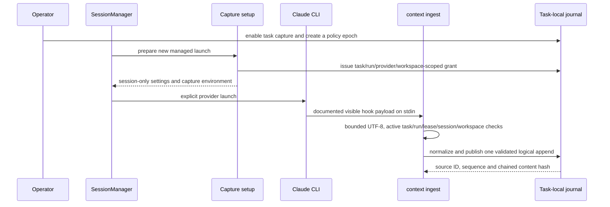

# Continuity architecture and data contracts

This page describes the **experimental continuity architecture** in the alpha.5.5 CLI.
It complements the [decision record](architecture-decisions.md), [CLI reference](cli-reference.md),
and milestone evidence. Alpha.5.1 downloads do not contain this subsystem.

## 1. What is being transferred

Continuity transfers a bounded starting point about a task, not provider account state, hidden
reasoning, or a guaranteed complete conversation. The receiver still works on current repository
files. A submitted correction, provider-reported tool outcome, host-observed test exit, current
file excerpt, and assistant claim have different provenance and cannot replace one another.

The architecture deliberately separates five planes:

1. **Intent:** original task fields and exact retained submissions in receipt order.
2. **Historical evidence:** bounded reported actions/results and claims with source IDs.
3. **Current observation:** covered input identity and code actually read from that observation.
4. **Verification:** observed command start/end receipts, with environment gaps.
5. **Presentation/evaluation:** budgeted briefings, on-demand retrieval, named policy previews,
   and benchmark evidence about their correctness/cost.

No model call is used to infer requirements, supersession, dependency edges, or an invented next
action. Conflicting submissions remain inspectable. ADR-025–041 explain the tradeoffs.

## 2. Module responsibilities

| Modules in `src/context/`                                          | Responsibility                                                                                             |
| ------------------------------------------------------------------ | ---------------------------------------------------------------------------------------------------------- |
| `schema.ts`, `store.ts`                                            | Observation/event schema, task policy, capture grants, bounded hash-linked journal, gap diagnostics        |
| `capture.ts`, `claude.ts`                                          | Managed session-local Claude hook setup, active-run validation, visible-field normalization                |
| `codex.ts`                                                         | Passive visible exec-JSON normalization used by benchmarks; not general native TUI capture                 |
| `paths.ts`                                                         | Historical path preview detection and display notice; no filesystem sandbox                                |
| `briefing.ts`, `render.ts`                                         | Coverage analysis, whole-submission-first selection, exact source excerpts, continuity fingerprint         |
| `snapshot-schema.ts`, `snapshot.ts`                                | Separately versioned covered-input observation, stable content scans, optional derived text capture        |
| `verification-schema.ts`, `verification.ts`                        | Pending/completed/interrupted receipts, partial environment identity, conservative freshness               |
| `inspection-schema.ts`, `inspection-code.ts`, `inspection.ts`      | Bounded current-state packet, Git-blob display comparisons, omitted-source accounting and derived cache    |
| `retrieval-schema.ts`, `retrieval-index.ts`, `retrieval-cursor.ts` | Validated queries, journal-bound exact-field index, source/query-bound continuation                        |
| `retrieval-file.ts`, `retrieval-output.ts`, `retrieval.ts`         | Stable bounded request-file transport, exact evidence/file windows, full-envelope fitting and fair batches |
| `prompt-policy.ts`                                                 | Rendering-only output/layout transformations with control fallback and byte-prefix diagnostics             |

`src/cli/context.ts` resolves the current actor/workspace and exposes read-only lookup/control
commands. `src/lifecycle.ts` is the composition point; `src/application/sessions.ts` injects the
managed-run capability/settings and performs prelaunch checks. Benchmark modules remain a
separate execution/measurement layer.

## 3. From managed launch to durable source



### Consent and authority

Capture policy is independent of token-analytics opt-in. `enable`/`disable` changes the task's
policy epoch; grants from a previous epoch are invalid. `clear` disables capture and removes only
recognized generated capture files for that task. Task state, Threads, checkpoints, verification
receipts, and other tasks are not deleted by this command.

Managed processes cannot use the consent/deletion CLI as the operator. A normal local shell is
the same-user operator boundary; these markers/capabilities do not isolate a malicious same-user
process that can directly access files. Explicit operator full-evidence lookup can read retained
records after disable; automatic handoffs and task submission pages exclude disabled capture.

The launcher currently installs capture hooks only for Claude. It merges with existing generated
session settings, preserves other hook entries, and does not rewrite provider-global config.
Generated handoff prompts are recognized as `launch_prompt`, keeping them out of the later
submitted-instruction stream. A picker/resume grant can bind its first observed provider session.

Lifecycle status hooks described in [runtime protocols](runtime-protocols.md) are separate. A
Codex/OpenCode permission-wait indicator does not mean submitted instructions/tool results were
captured for continuity.

### Validation and append mechanics

Ingestion bounds stdin, decodes UTF-8 strictly, verifies the current task/run/lease and provider,
and validates the reported workspace against the grant. Normalizers read only supported visible
fields, redact recognized secrets, and record source truncation. Numeric command exits are kept
only when exposed; a successful hook alone does not imply a successful test.

Publication holds the task context lock, rechecks the grant/epoch, validates the existing chain,
deduplicates a stable source ID where one exists, and constructs the next canonical event body.
The stored hash covers that body including the previous hash. A private temp file containing the
bounded complete journal is fsynced, renamed, and its directory synced where supported.

This is a **logical append implemented through bounded replacement**, not the incremental
benchmark trace writer. Reads accept complete newline-terminated records before an incomplete
tail and disclose the gap. Append refuses a torn tail; a malformed complete record/hash/sequence
fails integrity validation rather than silently accepting partial history.

Hashes establish content consistency under the recorded hash, not authenticated authorship.
A process with sufficient local filesystem access could rewrite content and its hashes.

## 4. Identity and provenance map

| Identifier                     | Meaning                                                                             | What it is not                                                |
| ------------------------------ | ----------------------------------------------------------------------------------- | ------------------------------------------------------------- |
| Task/session ID                | Current durable task namespace                                                      | Provider conversation identity                                |
| Operation ID                   | Caller-supplied launch/mutation retry identity                                      | A fresh paid-attempt allowance                                |
| Run ID                         | Stable task/operation-derived provider-run identity                                 | Terminal display label                                        |
| Terminal UUID                  | Daemon-owned live terminal identity; commonly reused as launch operation ID         | Provider transcript ID                                        |
| Provider session ID            | Only the official exposed/explicitly selected resume target                         | Rirei-owned conversation storage                              |
| Managed workspace UUID         | Registry entry for an isolated Git worktree                                         | Content hash or security sandbox                              |
| Repository workspace key       | Directory namespace from canonical repository identity/remote                       | Authorization secret                                          |
| Context workspace key          | SHA-256 of the normalized worktree path; callers canonicalize before storage/lookup | The M2 covered workspace identity                             |
| Event `e-…` ID                 | Retained source reference                                                           | Proof of a human author or complete tool coverage             |
| Event hash                     | Canonical record/previous-hash consistency                                          | Cryptographic origin attestation                              |
| Retained-text digest           | SHA-256 of the sanitized text returned by full/window lookup                        | A digest of uncaptured original text                          |
| Derived `c-…` command ID       | Provider/run tool group, or exact retained command group when no tool ID exists     | Proof a command executed or inferred file dependency          |
| Legacy Git fingerprint         | Commit/branch/status/combined tracked patch anchor                                  | Actual untracked content or test-start/environment identity   |
| Covered snapshot ID            | Tagged v1 identity of the declared observed input set                               | Complete filesystem/environment equivalence                   |
| Verification receipt UUID/hash | Observed configured-command lifecycle record and consistency                        | A hermetic test certificate                                   |
| Inspection packet ID           | Snapshot, semantic task, journal, environment, command and focus identity           | A persistent authoritative source cache                       |
| Retrieval cursor               | Bounded continuation bound to source/query/context                                  | Permission token, encryption, or provider conversation resume |

Canonicalization matters: `path.resolve` alone does not collapse filesystem aliases such as
macOS `/var` and `/private/var`. Production setup/lookup canonicalizes at the boundary; benchmark
copies must do the same before rebinding workspace keys. The saved M3 replay caught this exact
fixture-setup mismatch.

## 5. Requirement-first briefing

`render.ts` loads consented sources for the current workspace, derives pending tool requests,
missing starts/ends and capture gaps, then invokes `briefing.ts`. Selection works as follows:

1. Construct whole retained submissions. If all fit, keep them in receipt order.
2. Otherwise choose newer whole submissions first, without rewriting wording or deduplicating
   intentional repeated instructions.
3. Consider exact sentence/line spans only as fallback previews. Their offsets refer to retained
   text; they cannot establish requirement completeness.
4. Fill remaining space with source-linked pending/failing results, reported edits, claims and
   optional current-state lookup. Historical path-bearing tool/assistant previews can yield to
   source citations instead of repeating old workspace paths.
5. Account for labels, coverage notices, omissions, and the required lookup instruction before
   declaring the final text within its ceiling.

`submissionCoverage` records retained count, fully inline count, required source IDs and source
truncation/redaction. A required task lookup follows `submittedMessages.nextAfter` until null.
Missing original source text cannot be recovered by pagination; clarification remains necessary.
An empty `task.requirements` array does not erase requirements in later captured submissions.

Reported failures before a later edit remain historical/unverified for current code. Repeated
command output may be grouped, but a claimed diagnosis is not promoted to verified truth and
receipt order alone does not establish parallel-tool causality.

## 6. Covered input observation

The M2 identity is separate from checkpoint/note/run-start fingerprints. A scan collects Git
HEAD/branch/common-directory identity, the filtered HEAD tree, exact staged index entries, and
nonignored untracked paths using NUL-delimited output. HEAD/index tracked-path union preserves
paths removed from the index even if newly ignored. Stages/flags expose unmerged/sparse cases.

For ordinary covered files the scanner validates path/ancestors, refuses linked ancestors,
checks canonical containment, opens without following a final symlink where supported, compares
device/inode/stat stamps around chunked content hashing, and rechecks the namespace. File modes
and deletion state are included. No unchanged-mtime/size cache substitutes for reading bytes.

Git metadata is checked around each pass; two consecutive complete content identities must agree.
One additional pass can recover an altered boundary. Continuous changes are `unstable`; time/size/
read errors produce `partial`/`unavailable`. The final returned identity covers only the last
qualified observation and explicitly declares its scope.

Internal recorder paths and sensitive filenames are excluded from content reads. Symlink target
strings are metadata, never target-content authority. Git tree/index entries bind pinned gitlink
commits; checked-out submodule commits/dirty contents are unmeasured. Ignored/generated inputs
and arbitrary external configuration remain outside declared coverage.

Optional derived data does not change the v1 identity algorithm:

- M3 retains a small set of display text and Git blob IDs, with display-specific bounds.
- M4 can retain up to eight explicitly requested regular UTF-8 files from the same consistent
  scans, including BOM/CRLF. A hash-only read qualifies only that file, even if another input
  category makes global coverage partial.

`complete` means the declared file scope was observed consistently. It does not prove no transient
mutation occurred, enforce an OS read sandbox, or qualify dependencies/services/environment.

## 7. Host-command verification

```text
persist pending receipt
  -> run the explicit configured shell command with inherited stdio
  -> observe numeric exit or interruption
  -> scan end inputs/environment
  -> publish completed/interrupted receipt and linked legacy test entry
```

The start/end identity, command digest, working directory, task ID, timestamp and monotonic
duration make a result more specific than an assistant success claim or old run-start anchor.
The command is redacted before hashing; output remains `not-captured`. Up to 64 receipts are
retained, pruning nonpending entries first. A full unresolved ledger refuses another receipt.

The environment identity records Node version/platform/architecture/executable-path digest and
conventional values/presence for `NODE_ENV`, `TZ`, `LANG`, `LC_ALL`, `CI`. Nonstandard, oversized,
control-containing or recognized-secret values are withheld without secret-value hashes.
Installed dependency contents, external tools/services, ignored/generated data, outside environment,
clock/randomness, and the interval between observations stay unmeasured.

| Freshness             | Interpretation                                                                                             |
| --------------------- | ---------------------------------------------------------------------------------------------------------- |
| `pending`             | Start persisted; no complete result observed                                                               |
| `historical`          | Legacy/missing/interrupted/integrity-failed or insufficiently qualified evidence                           |
| `stale`               | Command, input identity, workspace, or observed environment differs, including during the test             |
| `current-observation` | Observed result with matching covered boundaries, still partial environment/interval qualification         |
| `reuse-eligible`      | Classifier-only trusted deterministic scope with all required coverage/controls; no current CLI creates it |

A nonzero/null exit cannot complete `finish --run-tests`. A controller crash can leave a durable
pending receipt. Matching boundaries never automatically skip tests or rerun historical commands.
Receipt and current-input changes participate in preview/prelaunch invalidation.

## 8. Inspection and exact retrieval

### Inspection is a presentation packet

`context inspect` prioritizes exact retained requirements, then verification/recorded actions,
changed-file metadata, and optional source display. Current code comes from the scanner's
stable bytes. Historical HEAD/index comparisons read immutable Git blobs by recorded object ID,
without external diff/textconv filters. Staged and worktree changes remain separate, including
index/worktree cancellation. Renames are deletion/addition rather than inferred intent.

Display comparisons bound line-comparison work, hunks, lines and characters. Binary, missing,
unreadable, sensitive, oversized or omitted code is explicit. Unchanged directly cited files
receive bounded opening windows because captured file paths do not supply verified line ranges.
No static dependency graph is inferred. An incomplete snapshot produces metadata-only code context.

The eight-entry packet cache stores derived output only. Cache identity includes snapshot,
semantic task state, journal/consent, observed environment, configured command, focused path,
format, budget and code selection. Current scans/guards still run; the cache does not authorize
stale source reuse.

### Retrieval is an exact source contract

`evidence-window`, `file-window`, and `evidence-matches` are different types. Evidence uses exact
retained sanitized text; file reads use exact observed UTF-8 bytes, including BOM/line endings.
Recognized-secret file contents are withheld rather than silently changed into an “exact” result.
M3 display redaction/truncation is therefore intentionally different from M4 exact-file semantics.

Windows report source identity, provenance, requested/actual ranges, capture versus page truncation,
and continuation. Character offsets are zero-based UTF-16 with exclusive ends. File lines are
one-based and columns zero-based; long lines resume by exact offset. Surrogate adjustments are
reported so cursor pages concatenate without gaps/duplicates. A final newline can yield an
exclusive EOF coordinate on the following line without creating an extra source line.

The four-entry evidence index is rebuilt/reused only after journal validation and is keyed by
version/task/workspace/journal digest. Find intersects exact reported file/kind/tool/command fields;
it never executes historical commands or derives dependencies from shell arguments.

### Cursors and batch status

Cursors bind semantic task state, canonical workspace, consent epoch/history, source and query
filters/ranges. Internal framing includes version/kind, a binding digest, continuation positions,
batch scheduling position and checksum. These are opaque validated continuations, not authenticated
grants. They have no separate wall-clock expiry; relevant context/version changes invalidate them.
Normal actor/source access checks run again.

Format and envelope ceiling may change while resuming the same semantic query. A batch has at
most eight queries, returns every query ID with `ok`/`error`/`deferred`/`done`, and rotates after
progress so a large early source does not hide later queries. A source error is explicit and
does not discard other results. A zero batch process exit does not mean all queries succeeded.

A regular relative UTF-8 request file is transport, not authority to escape the workspace. It can
be Git-ignored. Create a covered request file before taking its snapshot and pass that anchor on
the command line; embedding the resulting identity in that same file would change its identity.
The file digest is rechecked before return. Legacy full `task`/`history`/`evidence` formats remain
supported and are not retroactively constrained by new window limits.

## 9. Profile composition and freshness

M5 is a rendering-only ablation. `control` is the existing composition. `focused-output` adds
provider-neutral edit/check/final-response guidance; `stable-layout` reorders already-selected
sections with current workspace early and runtime warnings later; `stable-focused` combines them.
No profile reselects requirements/evidence to reserve policy room. All extra prompt characters
charge existing legacy headroom; otherwise the entire control rendering is retained explicitly.

In JSON, `text` is the actual candidate prompt. `continuity.text`, source excerpts and coverage
remain the control-selection audit view, which may no longer be a contiguous block after reorder.
Profile metadata records requested/effective strategy, fallback, text hashes, versions and exact
static-prefix bytes/hash. Every cache/receiver-output benefit field remains unmeasured absent
separately supplied qualified observations.

Switch preview compares a fresh rendered document after approval; task/context fingerprints are
rechecked with lease acquisition, and an approved complete input identity is reobserved immediately
before spawn. These are race-detection checks, not an immutable execution snapshot. M5 previews
are not silently activated by native `run`/`switch`; integration/promotion remains a later gate.

## 10. Bounds and units

| Surface                              | Main bound                                                                                          |
| ------------------------------------ | --------------------------------------------------------------------------------------------------- |
| Hook input / retained text field     | 256 KiB input; 16,000 UTF-16 units per text field                                                   |
| Context journal                      | 2,000 events / 4 MiB                                                                                |
| Legacy capsule / continuity postlude | Default 1,200 characters and ~300 tokens; separate 6,000-character postlude                         |
| Covered scan                         | 2,000 files, 1 MiB/file, 16 MiB/pass, 2 MiB/Git output, 3-second total deadline                     |
| M3 display capture                   | 16 files, 64 KiB/file, 256 KiB total; historical blobs 64 KiB/object and 256 KiB/1 second total     |
| M3 code display                      | 24 excerpts; 4 hunks/comparison; 32 lines/1,600 characters per hunk; cited opening windows 24 lines |
| Inspection envelope                  | 6,000 default / 12,000 maximum characters, minimum 1,200                                            |
| Single retrieval envelope            | 2,000 default / 8,000 maximum characters, minimum 1,200                                             |
| File range / exact retained file set | 60 default / 1,000 maximum lines per page; up to 8 files at 1 MiB each                              |
| Batch envelope / request transport   | 8 queries; 12,000 characters maximum, minimum 2,400; 32 KiB request and 3-second read deadline      |
| Verification                         | 64 receipts, 4,096-character command display; environment always partial in the CLI                 |

Final response fitting includes escaping, metadata, cursors, labels, budget counters and newline.
Optional content yields before requirements. Bytes, UTF-16 units, exact provider tokens, and
estimated character/4 tokens are different measurements. Exceeding a bound is an explicit gap,
fallback, or error, never silent complete coverage.

## 11. Evaluation and observed failure policy

M0–M1 freeze controls and harden the benchmark runtime. The benchmark writer is a separate
incremental stream with backpressure, bounded UTF-8 records, persistence sequence accounting,
periodic/final fsync, and incremental metric replay. It may terminate its own faulty benchmark
child; optional production capture does not kill a user's provider on a logger gap.

The shared attempt ledger reserves before spawn. Explicit recovery binds new unattempted keys
to the same original cap/protocol/stop record; it does not erase authentication/storage failures.
Private control archival verifies each copied hash before publishing a complete manifest.

Provider counters keep cache creation/read, output and reasoning separate; missing values stay
null, and reasoning already included in output is not added twice. Host-monotonic receipt spans
include transport/buffering and are not model CPU/thinking profiles. Prefix equality is only a
byte-layout diagnostic. M5 plans AB/BA receiver/version contrasts but authorizes zero launches;
current output/cache/continuation benefit remains unmeasured.

The separately approved [E1 default-candidate smoke](../benchmarks/continuity/reports/e1-2026-11-18.md)
subsequently used eight fresh receivers: frozen control and current candidate each passed 4/4
strict cases. Efficiency was mixed. No context helper was invoked, and a native login shell
shadowed the helper PATH alias with the installed CLI for bare message queries. This qualifies
the observed inline handoffs, not native targeted retrieval or M5 output/layout benefit. Future
runtime preflight must exercise the explicit versioned helper through the actual shell.

The latest successful full code suite was M5's 850 passed / 3 skipped in serial execution. Earlier
parallel attempts hit snapshot/message-lock deadlines and are retained in the milestone record.
The current documentation audit does not re-label those failures or claim a new native/live score.
For exact as-tested hashes, budgets, measurements and remaining gates, follow the M0–M5 notes and
the [architecture audit ledger](architecture-audit.md).
